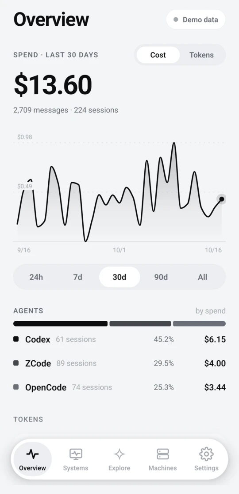
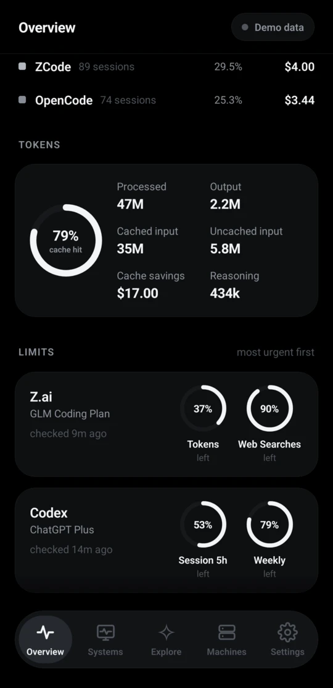
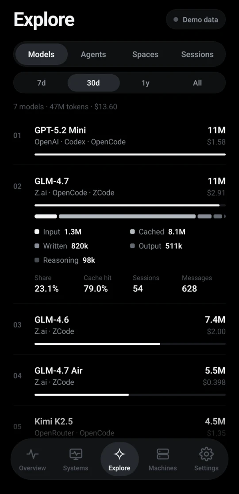
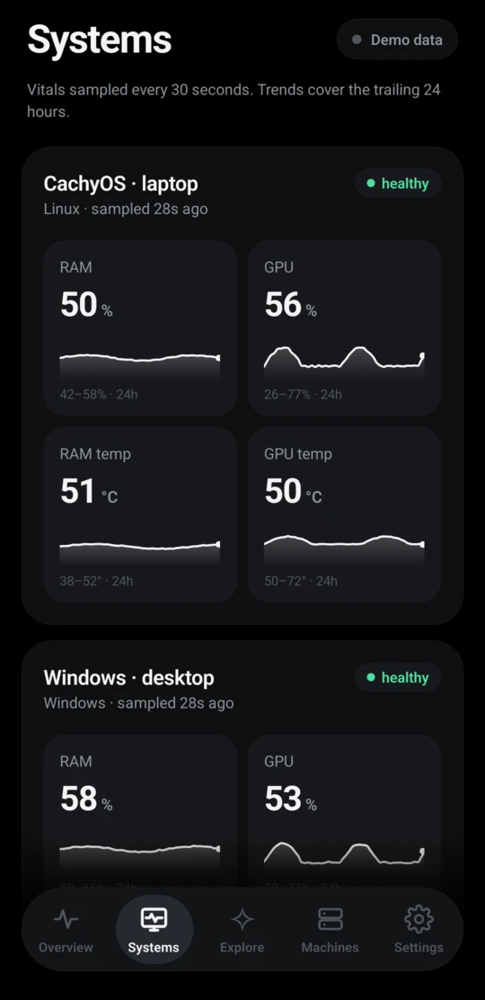

# burn

**Every token you burn. Every machine. One phone.**

Track your AI coding agents across Windows, WSL, Linux and macOS:

- **Spend**: dollars and tokens per agent, model, workspace and session
- **Cache hits**: how much of your input came from cache
- **Limits**: vendor quotas (Claude, Codex, Z.ai and more) with reset countdowns
- **Health**: RAM, GPU and temperatures per machine

No servers. No accounts. No telemetry.

<p align="center">
  
  
  
  
</p>
<p align="center"><sub>Light or dark, your call. Demo data: machines, usage and prices are made up.</sub></p>

## How it works

```
machine: tokscale + burn-events → burn-report daemon ← Tailscale → phone: Expo + SQLite
```

- **Machines are the backend:** each runs `burn-report daemon`, a read-only server (plus one opt-in control, below).
- **[tokscale](https://github.com/junhoyeo/tokscale) parses and prices** ~50 AI clients.
- **The phone pulls over Tailscale** and keeps an offline copy.
- **Machine offline?** Its history is still there.

## Quickstart

**1. Join one tailnet.** Install [Tailscale](https://tailscale.com/) on every machine and your phone.

**2. Start a reporter on each machine.**

```bash
curl -fsSL https://raw.githubusercontent.com/ensevengg/burn/main/scripts/install.sh | sh
burn-report daemon             # prints what to add on the phone
burn-report install-service    # optional: start it at every login
```

Binaries are attached to each `burn-events-v*` release; until one exists for your platform, use [From source](#from-source) below. That is the whole setup: the machine is named after its hostname and the daemon waits for Tailscale if it is not up yet. The installer covers Linux x86_64 and Apple-silicon macOS and verifies checksums. On Windows, download `burn-report-windows-x64.exe` and `burn-events-x86_64-pc-windows-msvc.exe` from the [latest release](https://github.com/ensevengg/burn/releases/latest) into one folder, rename them `burn-report.exe` and `burn-events.exe`, and run `burn-report.exe daemon`.

**3. Open the app.** Run `bun run mobile` and open it in Expo Go on Android. Tap **Connect my machines**, then **Machines → +** and enter the machine's Tailscale name or address. Your other machines are offered right there once the first is added.

**Just looking?** Tap **Explore with demo data**.

### From source

Needs Bun and a Rust toolchain.

```bash
bun install
cargo install --path crates/burn-events   # once per machine
bun run reporter -- daemon
```

### Reporter tips

- **Rename a machine:** `burn-report init --slug my-machine --name "My Machine"`. Every flag is optional.
- **One slug per install:** Windows, WSL and each dual-boot side. WSL gets a `-wsl` slug by default.
- **Same box?** Share a `--host-group`. Windows and WSL share their hostname automatically.
- **Flags:** `--port 8787`, `--bind <address>`. `serve` is an alias for `daemon`.
- **Check a machine:** `burn-report doctor`.
- **Limits** (vendor quotas) need the tokscale CLI, which the reporter runs through Bun or Node if either is installed. Usage syncs without it.

## The app

| Tab | What you get |
|---|---|
| **Overview** | Spend or tokens, 24h to All. Drag the chart for any day. Agents, cache hits, limits. |
| **Explore** | Models, agents, workspaces, sessions. Ranked. |
| **Systems** | RAM, GPU, temps. 24h trends. Live fans and power mode on opted-in Linux machines. |
| **Machines** | Add by URL. Refresh or reconcile. |
| **Settings** | Theme, timezone, disconnect. |

- **Pull down** anywhere to refresh.
- **Header pill** shows progress: "Syncing 1/3".
- **Numbers glide**, and the total shows what the pull added.

## Sync, in short

- **Incremental:** only new rows travel.
- **Warm:** reporters scan in the background, so a pull does not wait for one.
- **Resumable:** big backfills continue while the app is open.
- **Self-correcting:** a daily reconcile catches late records and price fixes, downloading only from the first day that changed.
- **Independent:** a failed quota check never wipes good data.
- **Health:** sampled every 30s, 24h kept.
- **Phone-only deletes:** removing a machine clears the phone's copy, never the machine's.

## Upgrading

- **Restart reporters.**
- **Exporter:** rebuild or re-download `burn-events` with each release; the reporter refuses one built for another tokscale pin.
- **`push` is gone:** run `daemon` instead.
- **Kept:** reporter identity, phone history, settings and machine URLs.

Deep dives: [transfer behavior](docs/connection-transfer-fixes.md) · [why Tailscale-only](docs/adr/0003-tailscale-only-backend.md)

## Repo map

| Path | What |
|---|---|
| `apps/mobile` | Expo Android app |
| `apps/reporter` | `burn-report` CLI and machine backend (read-only, plus opt-in power mode) |
| `crates/burn-events` | Pinned Rust exporter of priced tokscale records (JSONL) |
| `packages/sync-api` | Transport, shared types, validation, mirror keys |
| `docs` | Decisions, transfer behavior, audits |

## Develop

```bash
bun run typecheck
bun run test
bun run --cwd apps/mobile android   # local Android build; needs JDK + Android SDK
```

- **Rules:** [AGENTS.md](AGENTS.md)
- **Why Tailscale-only:** [ADR 0003](docs/adr/0003-tailscale-only-backend.md)
- **Why the one write endpoint:** [ADR 0004](docs/adr/0004-opt-in-machine-controls.md)

## Next up

- Upstream `tokscale events --jsonl`
- Skia charts
- APKs on GitHub Releases
- QR onboarding
- Accurate model-price reference transport

## License

[MIT](LICENSE)
